# Hi, I'm James

I'm a Technical Support Lead at Vero Networks, a fiber internet provider. At home I run a homelab and build the tools that keep it running, from monitoring agents to Linux desktop apps. I'm looking for systems administration, infrastructure engineering and agentic AI roles.

🌐 [hufflabs.dev](https://hufflabs.dev) · 📫 [james@hufflabs.dev](mailto:james@hufflabs.dev)

## HuffLabs, my homelab

A self-hosted environment I designed, secured and run day to day.

| Area | What I run |
|---|---|
| Virtualization | Proxmox VE with LXC containers and VMs, Docker |
| Storage and backups | TrueNAS SCALE with ZFS, scheduled guest backups, encrypted restic backups |
| Networking | Self-hosted DNS with filtering, reverse proxy with TLS, Tailscale, Cloudflare Tunnels |
| Identity and security | Authentik single sign-on, role-based firewall rules, fail2ban, recurring security audits |
| Monitoring | Checkmk, plus a [Python watchdog](https://github.com/n0rthstar88/homelab-watchdog) I built that sends alerts and takes commands in Discord |
| AI agents | An [on-call agent](https://github.com/n0rthstar88/homelab-oncall-agent) for critical alerts: known problems get an allowlisted fix, and anything else goes to AI triage, limited by a gatekeeper that logs every command and rate-limits fixes |
| Automation | Python, Bash, Lua, Go, systemd |
| Operations | Runbooks, incident write-ups and disaster recovery documentation |

## Projects

- [Homelab On-Call Agent](https://github.com/n0rthstar88/homelab-oncall-agent): self-healing monitoring for Proxmox and Checkmk, with AI triage behind a security gatekeeper

  <a href="assets/projects/oncall-triage.webp">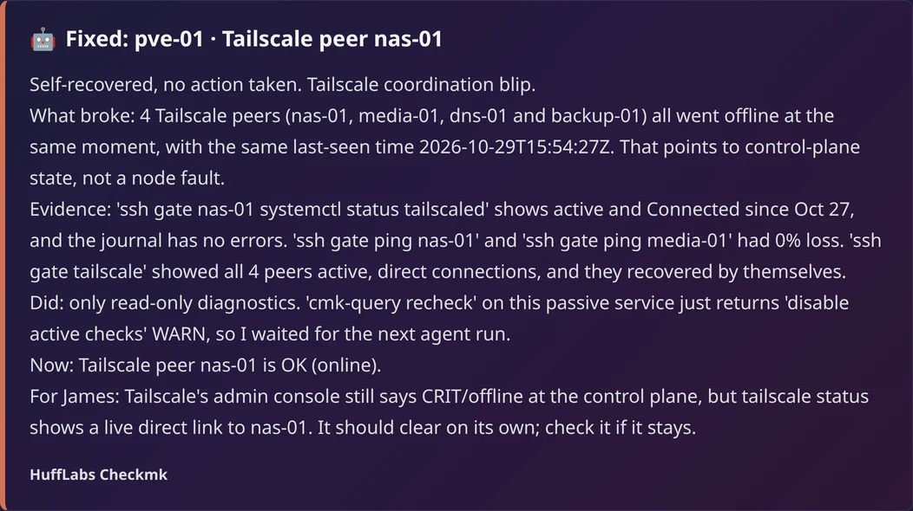</a>

- [Homelab Watchdog](https://github.com/n0rthstar88/homelab-watchdog): security and availability monitor with change-based Discord alerts and commands, in plain Python

  <a href="assets/projects/watchdog-alert.webp">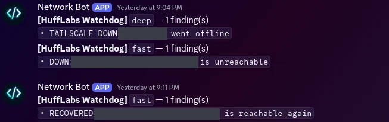</a>
   <a href="assets/projects/watchdog-ping.webp">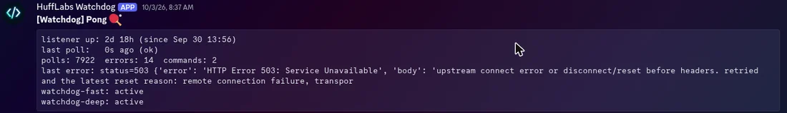</a>

- [HuffLabs RO](https://github.com/n0rthstar88/hufflabs-ro): a private game server for friends, reachable only over Tailscale, with an invite-only sign-up site, Windows and Linux installers, and a self-updating launcher that verifies signed updates. In Go, tested on Linux and Windows in GitHub Actions, with versioned releases

  <a href="assets/projects/ro-launcher.webp">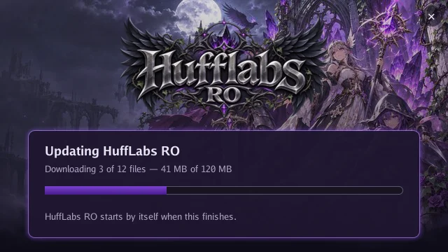</a>
  <a href="assets/projects/ro-signup.webp">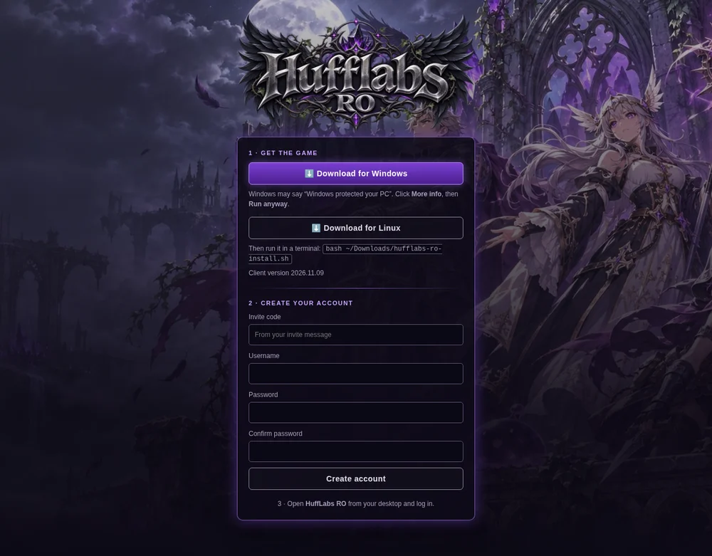</a>

- [PeripheralHub](https://github.com/n0rthstar88/peripheralhub): GTK4 app for keyboard, mouse, display and battery settings on Linux

  <a href="assets/projects/peripheralhub-lighting.webp">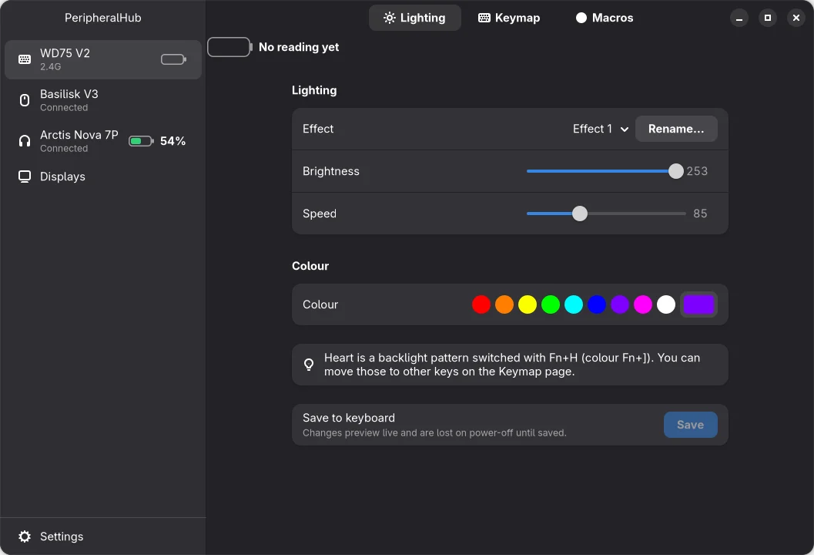</a>
  <a href="assets/projects/peripheralhub-dpi.webp">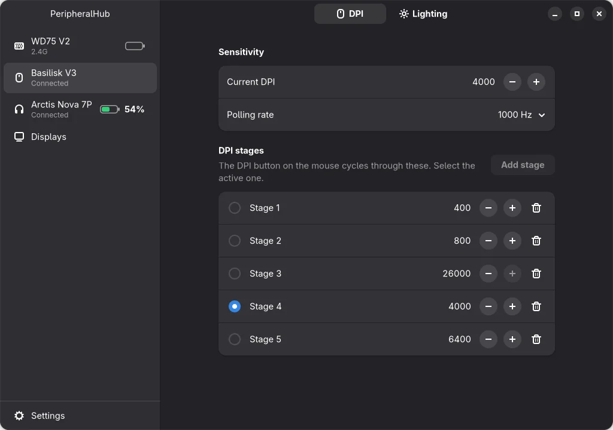</a>

- [Snap Layouts for Omarchy](https://github.com/n0rthstar88/omarchy-snap-layouts): drag a window to the top of the screen to pick a layout

  <a href="assets/projects/snap-picker.webp">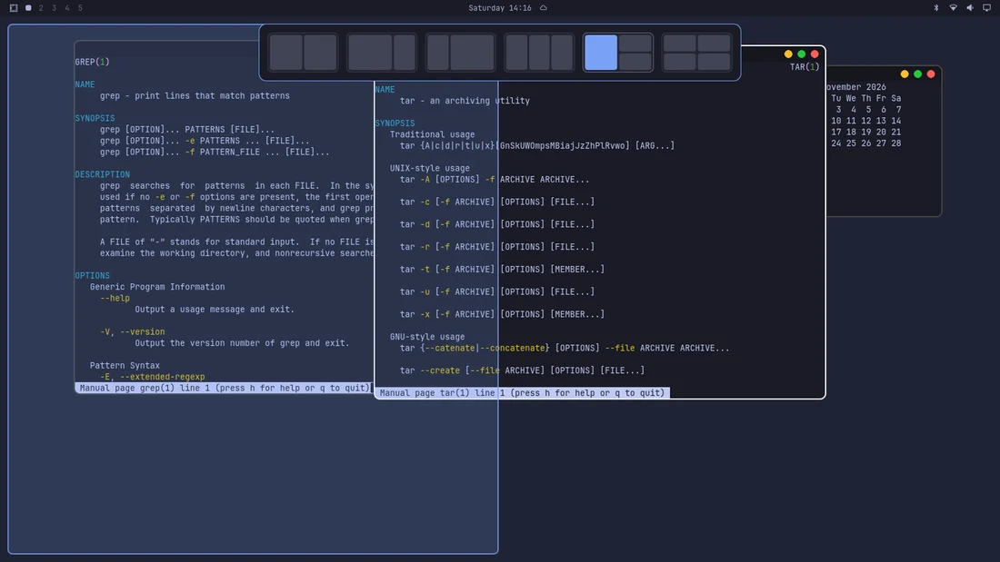</a>
  <a href="assets/projects/snap-snapped.webp">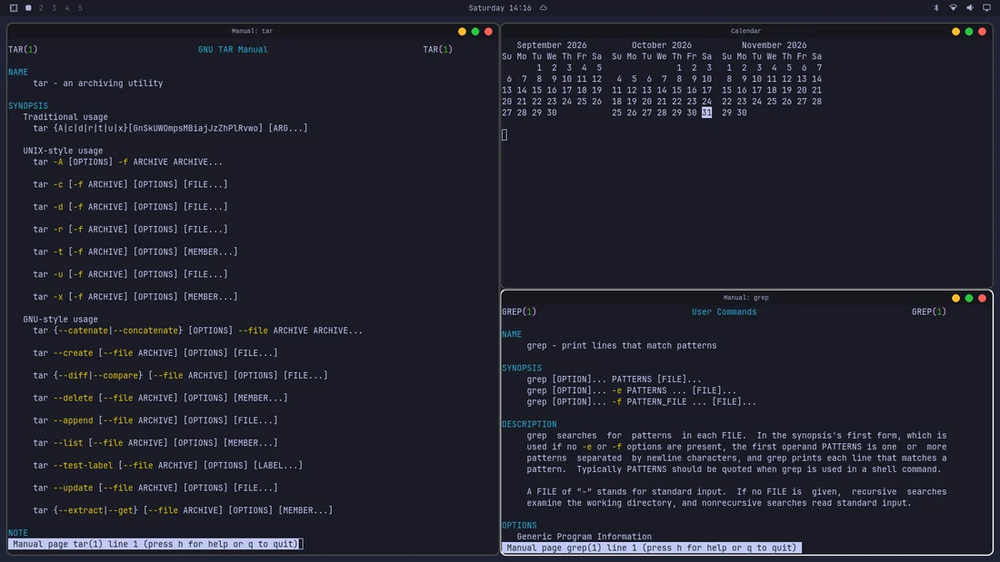</a>

- [Dark Magic](https://github.com/gravestench/dark-magic/pulls?q=is%3Apr+is%3Amerged+author%3An0rthstar88): 18 merged pull requests to an open-source Diablo II engine in Go and Lua

  <a href="assets/projects/darkmagic-code.webp">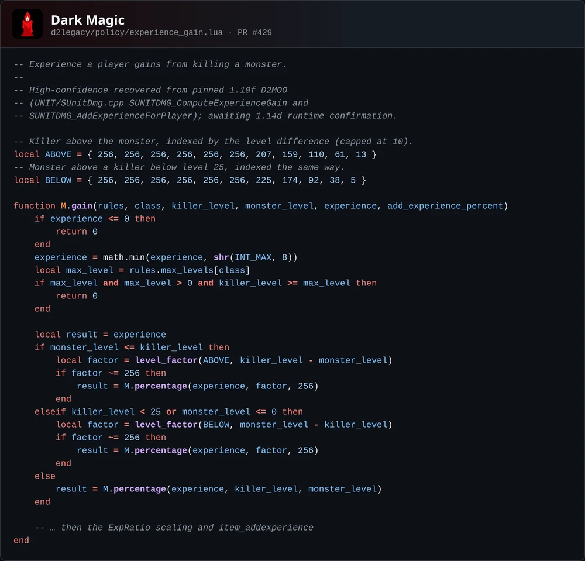</a>
  <a href="assets/projects/darkmagic-prs.webp">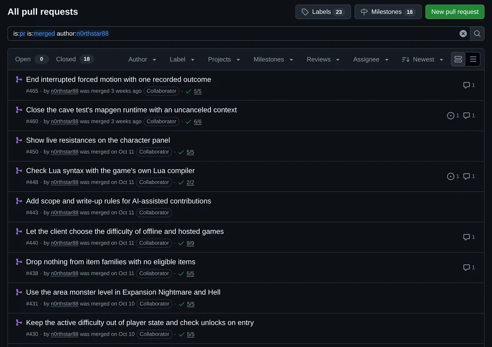</a>

